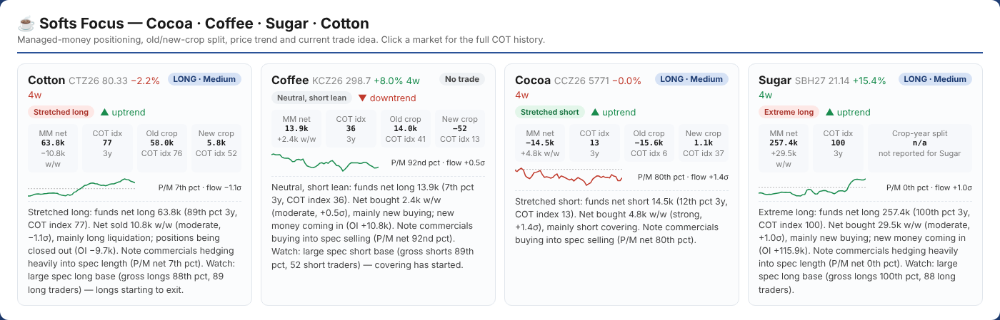
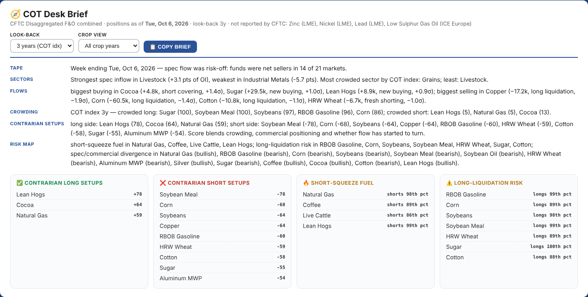
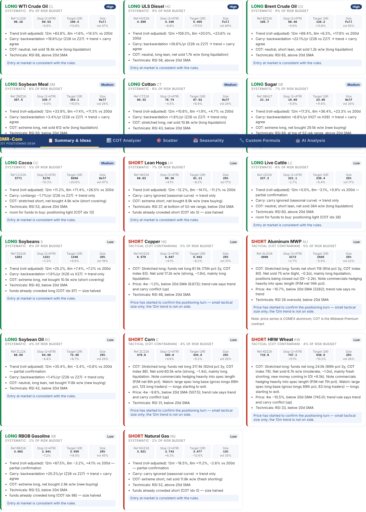

# BMR-Com · COT Positioning Desk

**Weekly CFTC positioning, price technicals and systematic trade ideas for Bloomberg Commodity Index (BCOM) markets, with a softs focus (cocoa, coffee, sugar, cotton).**

🔗 **Live dashboard:** https://bmr-com.github.io/cftc-cot-full/

The question it answers each week: *where are speculators and commercials positioned in each market relative to their own history, what changed this week, and does price agree?* It turns the raw CFTC report into a written desk brief, a positioning monitor and rules-based trade ideas. It updates itself every Friday after the CFTC release, with no manual steps.



---

## What's on the dashboard

| Section | What it shows |
|---|---|
| **Softs Focus** | Cocoa, coffee, sugar and cotton side by side: managed-money net and weekly change, COT index, **old-crop vs new-crop** positioning, price trend, producer/merchant percentile and the current trade idea. |
| **COT Desk Brief** | A written weekly read: breadth of spec flow, sector rotation, biggest buying and selling (sized as σ moves), crowding, contrarian setups and a risk map. One click copies it as plain text for notes or client emails. |
| **Trade Ideas** | Systematic long/short ideas with reference price on the actual contract (e.g. CTZ26), stop, target, size and rationale. Includes a watchlist of positioning setups waiting for price confirmation and a scorecard covering all 21 markets. |
| **Positioning Monitor** | Every market ranked by setup score: regime, net position, w/w change, flow σ, driver (new buying / short covering / long liquidation / fresh shorting), 52-week sparkline, COT index, commercial percentile and a one-line desk read. |
| **Index (CIT)** | Index traders from the CFTC Supplemental report (13 ag markets): dollar exposure (long, short, net), weekly flows for index traders vs managed money in lots and dollars by sector and market, percentile bars over 1/3/5/10 years and since 2006, the same position, trader-category, trader-count and position-size charts as the COT Analyzer, and breadth of index adding across markets. Also summarised in the Desk Brief. |
| **Triggers & Flows** | For every market: price levels where the 20/55/100-day breakouts and 50/100/200-day averages would flip (on the tradable contract, with distance in % and ATR), managed-money dollar exposure and weekly flows by sector, and a 26-week heatmap of fund positioning percentiles. |
| **Scatter** | Commercials vs funds percentile maps (contracts and % of open interest), plus "crowded and still adding vs crowded and exiting". |
| **Seasonality** | Weekly positioning by year against a 5-year range and average, for any market or basket, with crop-year panels for grains and softs. |
| **COT Analyzer / Custom Formula** | Full weekly history for one market across all four trader categories and crop years, with price on a right-hand axis (hidden automatically if the price feed is missing or stale), plus a formula builder for custom positioning ratios. |

Direct links: add a ticker or tab to the URL, e.g. `#CT` opens cotton in the COT Analyzer, `#index` or `#levels` opens that tab. The search box in the tab bar jumps to any market.



---

## Methodology

Desk reads, setup scores and trade ideas come from BMR-Com's rules-based framework, which combines CFTC positioning, price trend, term structure, volatility and commercial/speculator divergence. Outputs are systematic, intended for research and discussion, and **not investment advice**.



---

## How it works

```
GitHub Actions (Fri after CFTC release, retries Fri eve / Sat / Mon)
 ├─ scripts/prices.py        Yahoo Finance: daily OHLC (21 markets + S&P 500 / VIX),
 │                           current contract history, term-structure carry
 ├─ scripts/fetch_cit_data.py CFTC Supplemental (index traders, 13 ag markets) → data/cit_master.csv
 ├─ scripts/fetch_cot_data.py CFTC Socrata API by contract code → master CSV,
 │                           full-history percentiles, latest_summary.json
 └─ scripts/web_data.py      compact JSON for the browser:
                               data/web/manifest.json   (report date, ~1 KB)
                               data/web/snapshot.json   (all latest metrics, ~60 KB gz)
                               data/web/series/<TICKER>.json (weekly history per market)
GitHub Pages → index.html + js/
  data-store.js  version-keyed cache (localStorage / IndexedDB): a revisit with no new
                 CFTC data downloads only the 1 KB manifest
  insights.js    signal engine: desk brief and trade ideas
```

**Engineering notes:** problems found and fixed while building this.
- **Speed:** the original page made ~170 live CFTC API calls per visit (24 markets × 4 trader categories, plus the scatters). The tabs now render in under 0.3 s from pre-computed, browser-cached data.
- **Percentile bug:** incremental updates ranked new weeks only against the other new weeks. Cotton's managed-money net was stored at the 12.5th percentile when it was actually at the 82nd. Percentiles are now recomputed over the full history every run (vectorised, seconds), and checked against a brute-force calculation.
- **Silent data freeze:** WTI, Nat Gas and Brent stopped updating in Feb 2022 when the CFTC renamed those markets. Queries now use the stable CFTC contract code, and the update self-heals by backfilling each market from its own last date.
- **Roll gaps:** Yahoo's continuous series jumps on contract rolls (Lean Hogs −12% on Oct 15, Cotton −24% on the 2022 July→Dec roll). Trend measures use a ratio back-adjusted series; levels come from the tradable contract.
- **Missing trader count:** other-reportables short-trader counts were stored as 0 for every week because the parser used the wrong CFTC field name; fixed and rebuilt from 2006.
- **Seasonality double-counting:** two reports in one ISO week (holidays, shutdown catch-ups) were being summed.

---

## Coverage

21 CFTC-reported BCOM markets: Brent, WTI, Nat Gas, ULS Diesel, RBOB · Corn, Soybeans, Soybean Meal, Soybean Oil, SRW Wheat, HRW Wheat · Copper, Aluminum (COMEX Midwest Premium) · Gold, Silver · Sugar, Coffee, Cocoa, Cotton · Live Cattle, Lean Hogs.

Index-trader (CIT) data covers the 13 markets in the CFTC Supplemental report: Corn, Soybeans, Soybean Meal (from 2013), Soybean Oil, SRW and HRW Wheat, Cotton, Sugar, Coffee, Cocoa, Live Cattle, Lean Hogs and Feeder Cattle (CSV only).

Not available from the CFTC: Zinc, Nickel, Lead (LME) and Low Sulphur Gasoil (ICE Europe). COMEX outright aluminum stopped being reported in June 2026, so aluminum positioning uses the Midwest Premium contract (its price series is COMEX aluminum).

## Running locally

```bash
pip install -r requirements.txt
python scripts/prices.py          # Yahoo prices → data/prices/
python scripts/fetch_cot_data.py  # CFTC → data/ and data/web/
python -m http.server 8000        # open http://localhost:8000
```
`python scripts/check_markets.py` (or the **CFTC Market Check** workflow) lists which CFTC markets exist for each constituent and when each last reported.

---

*BMR-Com · independent commodity research. Data: CFTC Commitments of Traders and Yahoo Finance. Not investment advice.*
